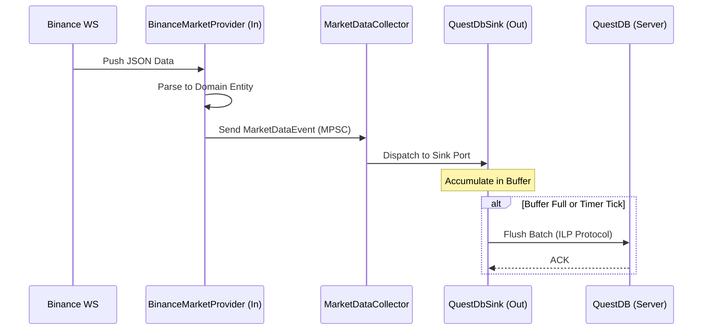
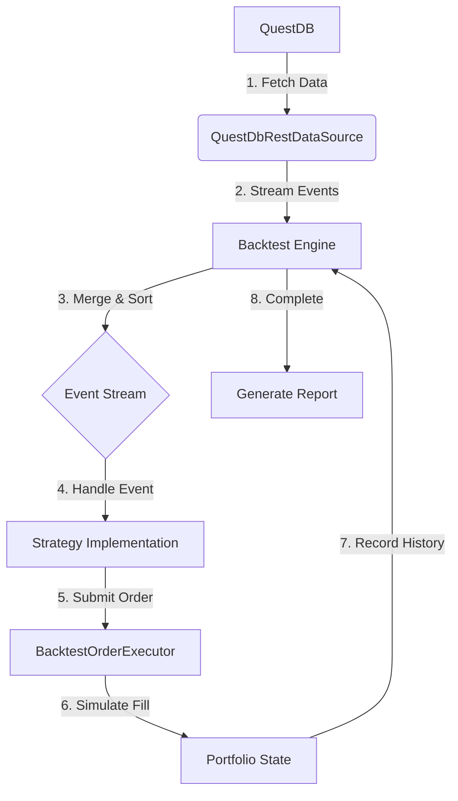
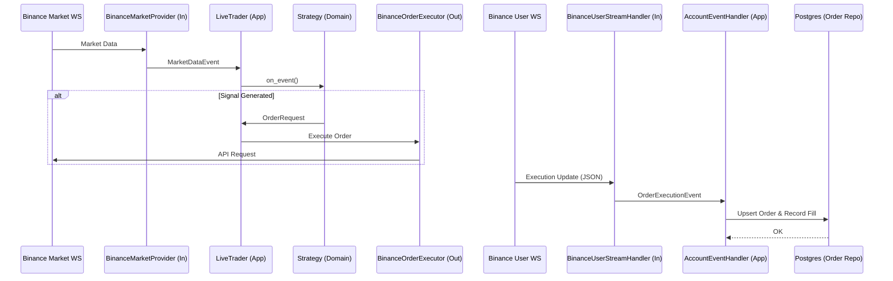

# 03. 데이터 흐름 분석

이 문서는 `trading-bot`에서 발생하는 핵심 유즈케이스의 데이터 흐름을 헥사고날 아키텍처 관점에서 추적하고 시각화합니다.

## 1. 실시간 데이터 수집 흐름 (Collector Flow)

외부 거래소(Binance 등)로부터 데이터를 수집하여 QuestDB에 저장하기까지의 과정입니다.

### 단계별 흐름
1. **Source (External)**: 바이낸스 WebSocket 서버로부터 데이터가 수신됩니다.
2. **Inbound Adapter (Binance Market Provider)**: 수신된 JSON을 도메인 엔티티(`Trade`, `Depth` 등)로 파싱합니다.
3. **Inbound Port (MarketDataProvider)**: 파싱된 데이터를 `MarketDataEvent` 채널로 전송합니다.
4. **Application Service (MarketDataCollector)**: 이벤트를 수신하여 필요한 처리를 거친 후 아웃바운드 포트로 전달합니다.
5. **Outbound Port (MarketDataSink)**: 데이터를 저장소로 보낼 준비를 합니다.
6. **Outbound Adapter (QuestDbSink)**: `mpsc` 채널 버퍼링을 거쳐 QuestDB에 배치(Batch)로 저장합니다.

### 시각화 (Sequence Diagram)

## 2. 백테스팅 실행 흐름 (Backtest Flow)

과거 데이터를 불러와 전략을 시뮬레이션하고 결과를 도출하는 과정입니다.

### 단계별 흐름
1. **Outbound Port (MarketDataSource)**: `application/backtest` 엔진이 지정된 기간의 데이터를 요청합니다.
2. **Outbound Adapter (QuestDbRestDataSource)**: QuestDB로부터 과거 데이터를 인출(Fetch)합니다.
3. **Application Service (Backtest Engine)**:
    - **Merge**: 여러 데이터 소스를 타임스탬프 순으로 병합하여 통합 이벤트 스트림을 생성합니다.
    - **Execution**: 각 이벤트마다 `Strategy` 핸들러를 호출합니다.
4. **Domain Logic (Strategy)**: 시장 데이터를 분석하여 주문(`OrderRequest`)을 생성합니다.
5. **Outbound Port (OrderExecutor)**: 주문을 제출합니다. 백테스트 환경에서는 `BacktestOrderExecutor`가 이를 처리합니다.
6. **Report Generation**: 시뮬레이션 종료 후 수익률, MDD 등을 계산하여 리포트를 생성합니다.

### 시각화 (Flowchart)

## 3. 실시간 트레이딩 흐름 (Trader Flow)

실제 시장에서 전략에 따라 주문을 실행하고, 체결 결과를 반영하는 실시간 트레이딩 과정입니다.

### 단계별 흐름
1. **Market Feed**: `BinanceMarketProvider`를 통해 실시간 `MarketDataEvent`를 수신합니다.
2. **Strategy Analysis**: `LiveTrader` 서비스가 현재 전략(`Strategy`)에 시장 데이터를 전달하여 매매 신호를 판단합니다.
3. **Order Submission**: 신호가 발생하면 `OrderService`를 통해 주문을 생성하고, `BinanceOrderExecutor`가 거래소 API로 주문을 제출합니다.
4. **Execution Event**: 거래소에서 체결이 발생하면 `BinanceUserStreamHandler`가 WebSocket을 통해 `OrderExecutionEvent`를 수신합니다.
5. **State Update**: `AccountEventHandler`가 이벤트를 처리하여 `PostgresOrderRepository`에 주문 상태를 갱신하고 체결(Fill) 내역을 기록합니다.
6. **Feedback Loop**: 갱신된 포트폴리오 상태는 다음 전략 판단 시 참고 데이터로 활용됩니다.

### 시각화 (Sequence Diagram)

---
[메인으로 돌아가기](./README.md) | [04. 기술 스택 및 아키텍처](./04_tech_stack_architecture.md)
